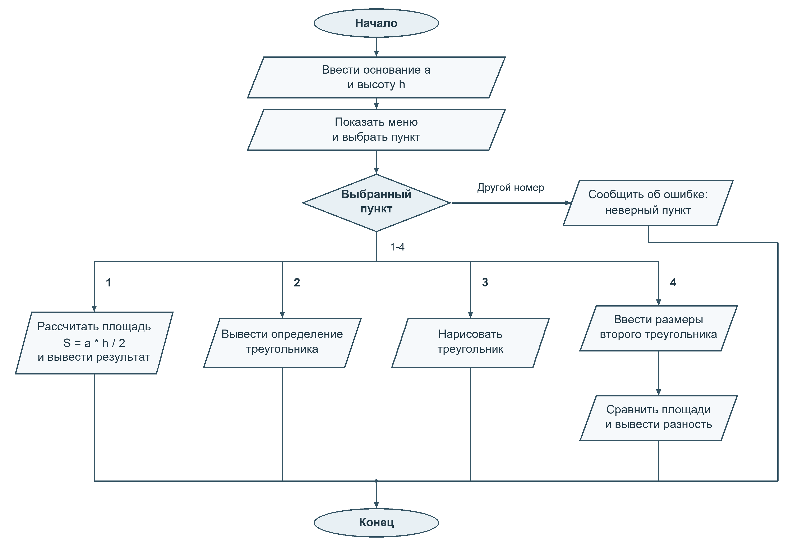

# Задание 3. Функции для работы с фигурой

## Вариант 6 - равнобедренный треугольник

Программа предлагает меню для вычисления площади, вывода определения
и рисования заполненного равнобедренного треугольника.
Также предусмотрено сравнение площадей двух треугольников, указанное в условии.

[Код программы на C](main.c)

## Ввод

Сначала пользователь вводит основание `a` и высоту `h` первого треугольника.
Основание должно быть положительным числом, высота - целым числом не меньше 1.
Затем выбирается один пункт меню:

1. Рассчитать площадь.
2. Вывести определение фигуры.
3. Нарисовать фигуру.
4. Сравнить площади двух фигур.

Программа выполняет выбранную операцию и завершается.
Дробное основание вводится через запятую, например `4,5`.

## Собственные функции

| Функция | Назначение |
| --- | --- |
| `area_triangle(a, h)` | Возвращает площадь `a * h / 2.0`. |
| `definition_triangle()` | Печатает определение равнобедренного треугольника. |
| `draw_triangle(h)` | Рисует заполненный треугольник звёздочками. |
| `get_height()` | Запрашивает высоту и возвращает введённое значение в `main`. |
| `compare_triangle(a1, h1, a2, h2)` | Возвращает площадь первого треугольника минус площадь второго. |

Равнобедренный треугольник - треугольник с двумя равными сторонами.
Высота `h` для расчёта площади проведена к основанию `a`.

## Примеры

### Площадь

При `a = 4`, `h = 3` и выборе пункта `1`:

```text
Площадь: 6,00
```

### Рисунок

При `h = 3` и выборе пункта `3`:

```text
  *
 ***
*****
```

Рисунок схематический: `h` задаёт число строк, ширина нижней строки равна
`2 * h - 1` символам. Основание `a` используется для расчёта площади,
а не для масштаба символьного рисунка.

В строке с номером `i` сначала выводятся `h - i` пробелов,
затем `2 * i - 1` звёздочек, после них - перевод строки.

### Сравнение площадей

Первый треугольник: `a = 4`, `h = 3`, площадь равна 6.
При выборе пункта `4` вводятся размеры второго треугольника.
Если его основание равно 3, а высота равна 2, площадь равна 3.

```text
Разность площадей: 3,00
```

Положительный результат означает, что первый треугольник больше по площади.
Отрицательный - второй больше. Нулевой - площади равны.

## Блок-схема



Каждый пункт меню показан отдельной ветвью: площадь, определение, рисунок
или сравнение. В ветви сравнения ввод размеров второго треугольника выделен
в отдельный блок. Неверный номер ведёт к сообщению об ошибке.
После выбранной операции все пути сходятся к блоку «Конец».

## Запуск в Visual Studio

Добавьте `main.c` в консольный проект и запустите программу.
Первая строка убирает предупреждение C4996 для `scanf`.
Функция `setlocale` подключает русскую локаль.

## Вывод

Написана программа на языке C с меню и собственными функциями
для вычисления площади, вывода определения, рисования фигуры,
получения высоты и сравнения площадей.
